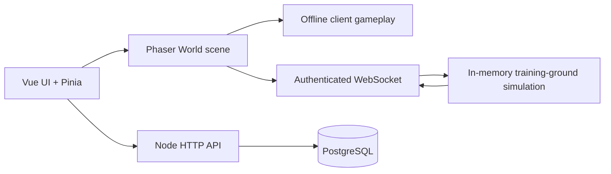

# CHIẾN GIỚI — Kiến trúc hiện trạng và đích gần

## Nguyên tắc

- Giữ repository và nền Vue/Phaser hiện tại; mở rộng theo lát cắt dọc.
- Vue quản lý màn hình/UI và Pinia; Phaser quản lý render, input và scene game.
- Khi có server realtime, client gửi ý định; server kiểm tra vị trí, chiến đấu và kết quả có giá trị.
- PostgreSQL là nguồn dữ liệu bền vững. Simulation realtime hiện chỉ ở RAM và chưa ghi kết quả combat vào database.
- Không đánh dấu hệ thống production-ready chỉ vì prototype có giao diện hoặc logic client.

## Thành phần đang có

| Lớp | Thành phần thực tế | Trách nhiệm / trạng thái |
|---|---|---|
| Client UI | Vue 3, Vue Router, Pinia | Game, inventory, settings; `src/views`, `src/stores` |
| Game runtime | Phaser 4.2, TypeScript | `Boot`, `Preload`, `World`; scene hiện gộp phần lớn gameplay world |
| Client systems | AutoBattleSystem, rewards, persistence | Combat offline, local save/settings, API sync |
| Shared protocol | TypeScript protocol v1 | Decode/validate lệnh và snapshot WebSocket |
| HTTP API | Node.js `http` tích hợp, không dùng Fastify | Auth, character save/load, enhancement; `src/server/app.ts` |
| Realtime | `ws` WebSocket | Session-authenticated socket và mô phỏng training-ground; một socket có simulation riêng |
| Database | PostgreSQL qua `pg`, migration SQL | Accounts, sessions, character data/forge theo migration hiện có |
| Dev proxy | Vite `/api` proxy | HTTP và WebSocket đến `127.0.0.1:3001` |

## Luồng hiện tại



## Cấu trúc repo hiện tại

```text
src/
  views/                 Vue views: Game, Inventory, Settings
  stores/player.ts       Pinia player state
  scenes/                Boot, Preload, World
  game/systems/           AutoBattle, reward rules
  game/persistence/       local save/settings and API client
  server/                 HTTP API, PostgreSQL repository, WS, simulation, SQL migration
  shared/                 realtime protocol and types
```

Đích mở rộng nên thêm module theo nhu cầu thật (character/world/combat/inventory), thay vì dựng sẵn cây thư mục rỗng. Tách `World` scene khi logic đủ lớn hoặc khi hệ thống mới cần ranh giới rõ ràng.

## Luồng dữ liệu và ranh giới tin cậy

1. Save hiện tại có thể ở local storage hoặc đồng bộ lên API.
2. API kiểm tra schema/range của character nhưng vẫn chấp nhận gold, inventory, equipment, quest hợp lệ do client gửi. Đây là rủi ro gian lận đã biết.
3. Forge endpoint thực hiện roll ở server và dùng transaction/row lock PostgreSQL, nhưng không thể bảo vệ toàn bộ progression khi endpoint save cho phép ghi lại dữ liệu client.
4. WebSocket yêu cầu session cookie, origin được phép và protocol version; giới hạn message/rate và xác thực session lại.
5. Simulation server tự tính di chuyển, range, cooldown, sát thương, death/respawn và EXP/gold. State đang riêng cho từng socket, không tồn tại sau disconnect/restart và không được persist.
6. Client guest tiếp tục chạy combat local, nên hai chế độ có authority và tính năng khác nhau.

## Công nghệ đích và quyết định theo giai đoạn

| Hạng mục đề xuất | Hiện trạng | Quyết định gần |
|---|---|---|
| Vue 3 + TypeScript + Vite | Có | Giữ |
| Phaser 3 | Repo khai báo Phaser 4.2 | Giữ phiên bản hiện tại; chỉ đổi engine khi có lý do tương thích đã xác minh |
| Fastify | Không có; Node HTTP tích hợp | Chưa cần migrate trước khi hoàn tất domain/API và kiểm soát save |
| PostgreSQL + Prisma | PostgreSQL + `pg` + SQL migration | Tiếp tục migration SQL hiện có; đánh giá ORM khi schema/domain tăng |
| Socket.IO | `ws` thuần | Giữ protocol v1; chỉ đổi nếu cần room adapter/transport features |
| Redis | Chưa có | Chưa cần cho single-process prototype; cân nhắc khi có session/cache/room scale-out |
| Docker/Nginx/monitoring | Chưa cấu hình trong repo | Giai đoạn deploy, sau khi xác định môi trường và secrets |

## Ranh giới kiến trúc đích gần

- **Client:** UI, render/input, prediction/feedback; không quyết định phần thưởng hoặc tài sản có giá trị.
- **Game server:** auth/session, character, zone, combat, inventory/economy theo module; ban đầu có thể vẫn là một Node process.
- **Data:** PostgreSQL bền vững; Redis chỉ khi có nhu cầu realtime phân tán đo được.
- **Operations:** env/secrets, HTTPS/proxy, logs, health checks, backup và khôi phục trước khi phát hành công khai.

## Hạn chế kiến trúc cần xử lý

1. Chuyển save/progression có giá trị sang lệnh domain phía server, ledger/transaction và kiểm soát quyền sở hữu; không nhận snapshot tài sản tùy ý từ client.
2. Định nghĩa cách persist và khôi phục simulation, đồng bộ nhiều người chơi theo zone, ownership và reconnect.
3. Tách content/config (maps, monsters, drop, balance) khỏi scene/simulation hard-code.
4. Bổ sung timeout/error UX cho API/socket và xử lý reconnect/resync có phiên bản.
5. Thiết kế migration có versioning/rollback/backup trước khi vận hành dữ liệu thật.
